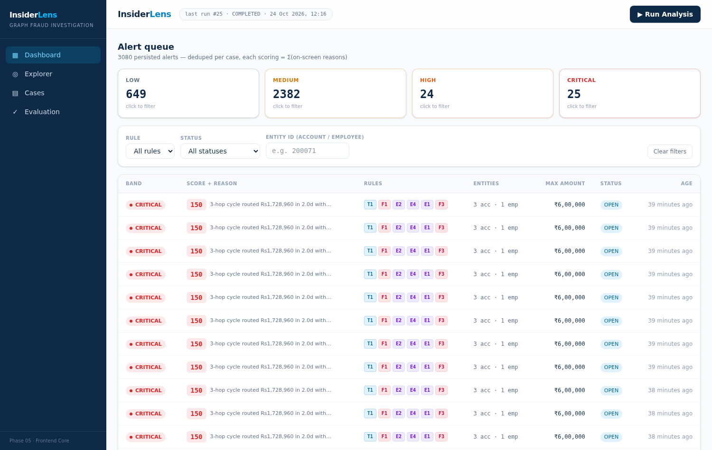
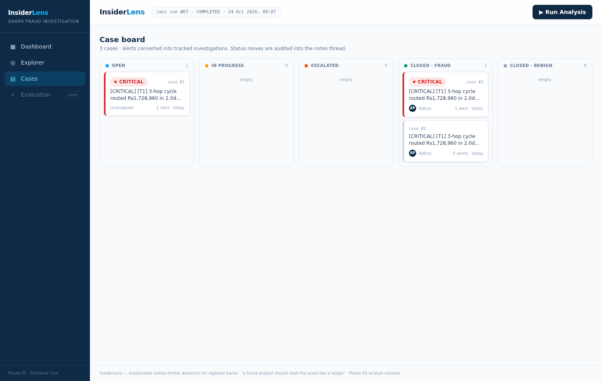
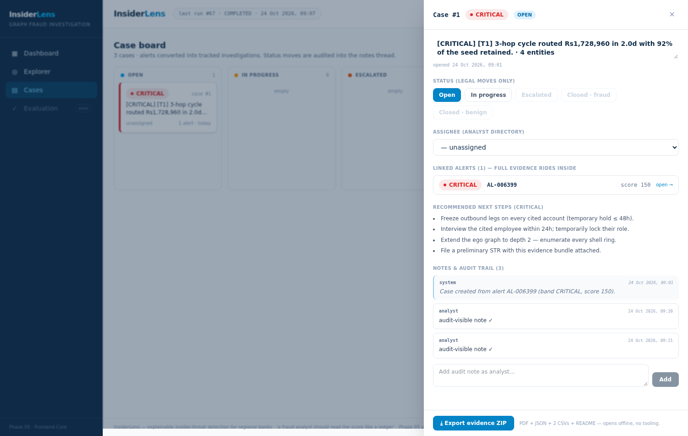
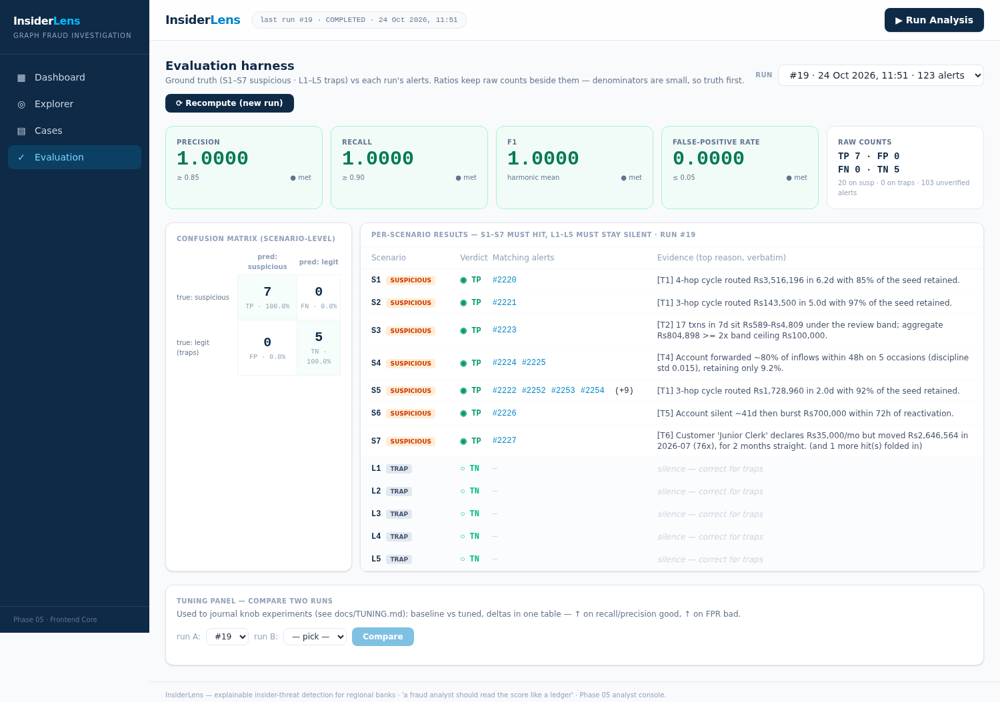
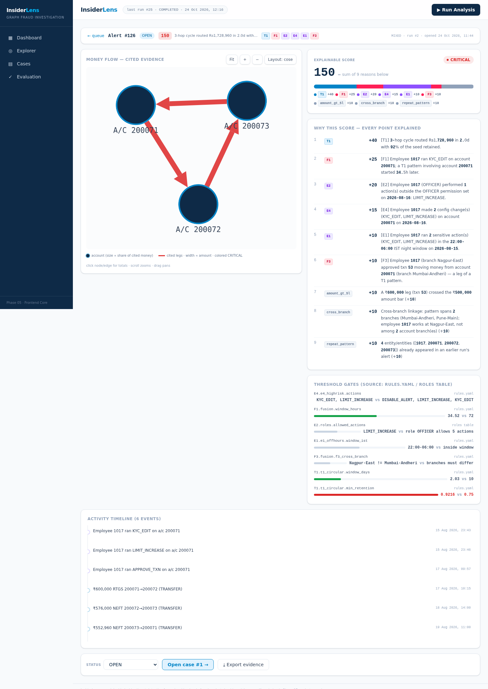
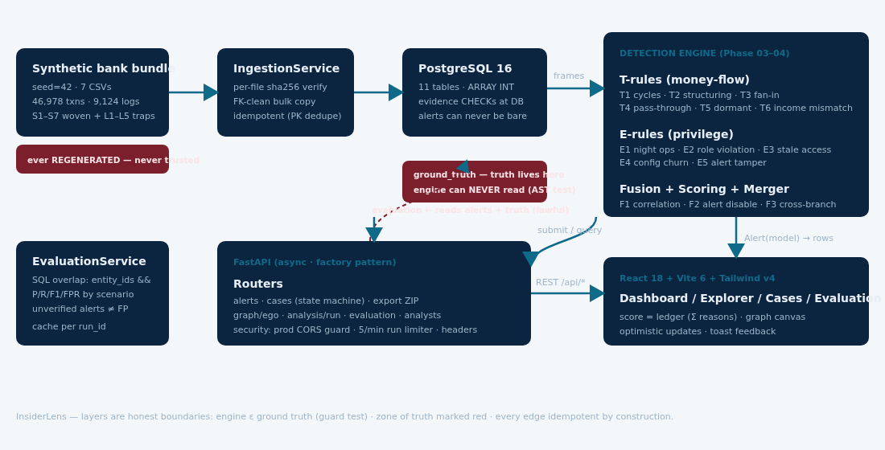

<div align="center">

# 🔍 InsiderLens

### Explainable Insider-Threat Detection for Regional Banks

**Every alert ships as a ledger — evidence, score math, graph, thresholds —
so an analyst can defend the verdict line by line. Never an opaque score.**

[](https://github.com/nalla-dinesh/insiderlens/actions)


</div>

---

> 🎯 **TL;DR:** Employees committing fraud from INSIDE a bank create a blind spot
> transaction-only fraud tools miss. InsiderLens fuses **transaction-money patterns**
> (circular flow, structuring, fan-in) with **employee-behaviour alarms** (off-hours
> KYC edits, role violations, bursts) inside **one explainable, audit-friendly platform**
> — and proves its verdicts against planted ground truth with measured metrics.

---

## 📋 Table of Contents

- [Why](#-why-insiderlens)
- [Features](#-features)
- [Screenshots](#-screenshots)
- [Architecture](#️-architecture)
- [The 13 Rules](#-the-13-rules)
- [Scoring & Bands](#-scoring--band-thresholds)
- [Ground Truth & Evaluation](#-ground-truth--evaluation)
- [Quickstart (Docker, 3 min)](#-quickstart-docker--3-minutes)
- [Manual Dev Setup](#-manual-dev-setup)
- [Make Targets](#-make-targets)
- [API Surface](#-api-surface)
- [Project Structure](#-project-structure)
- [Testing & CI](#-testing--ci)
- [Security](#-security)
- [Performance](#-performance)
- [Tuning Philosophy](#-tuning-philosophy-the-l-doctrine)
- [Roadmap](#-roadmap)
- [Contributing](#-contributing)

---

## 💡 Why InsiderLens

Scammers are outside the door — but banks bleed from **inside**. An officer edits a
customer's KYC at 2AM, disables an alert, approves his own circular transfer ring
days later. Each piece alone looks ordinary:

| Domain | What the fraudster does | What banking tools see |
|---|---|---|
| Money flows | cycles, structuring, sleeper wakes | "spread out, small amounts" |
| Employee actions | KYC edit, DISABLE_ALERT, limit up | "a config change log line" |
| The CORRELATION | **employee ↔ money same window/account** | **nothing links them** |

InsiderLens exists to close that link — **alarm fusion F1**: when an employee's risk
pattern and a theft-shaped flow meet inside 72 hours on the same account, a score soaks
the sky, and the whole evidence packet is handed to the analyst — offline-downloadable.

## ✨ Features

- 🕸️ **Graph-based detection** — NetworkX digraph over 500 accounts + employees,
  47k seeded txns: every pattern is a measurable shape, not a heuristic guess
- 📜 **13 rules** — 6 transaction, 5 employee, 2 fusion. *Rules.yaml is PROJECT LAW —
  every threshold lives there, boot fails naming any missing key*
- 🔬 **Ledger alerts** — per-alert evidence: why-fire blocks, exact thresholds,
  subgraph w/ node degrees, ₹-aware drill-down, related entities
- 🧾 **Case system** — kanban → state machine (OPEN→INVESTIGATING→RESOLVED→CLOSED)
  with gate enforcement (resolve needs note, close needs SAR audit), SLA countdowns,
  append-only audit trail, **Evidence-ZIP export**
- 📊 **Evaluation dashboard** — P/R/F1/FPR computed every run against planted GT
- 🧬 **Ground-truth governed** — 7 planted attacks (S1–S7) + 5 legitimacy traps
  (L1–L5), sha-256-signed bundle, tamper = 409
- 🛡️ **Production hardening** — CORS prod-refusal, rate limits, security headers,
  secret scanning, zero-dep vulnerabilities, non-root Docker, healthchecks, migration gates
- ↘️ **₹2-lakh sentence narrator** — deterministic "3-hop cycle routed ₹1,728,960 in
  2.0d with 92% retention" — evidence-driven, zero LLM hallucinations
- ⏱️ **Sub-120s pipeline** — full bank ingested + analyzed in ~20s; alerts at 13ms p95

## 📸 Screenshots

| | |
|---|---|
| **alert queue · bands · max-amount sort** |  |
| **case board — ₹-first investigation law (P4)** |  |
| **case drawer — SLA + state gates + timeline** |  |
| **evaluation — P/R/F1/FPR + per-scenario matrix** |  |
| **alert ledger — evidence blocks + subgraph** |  |

## 🏗️ Architecture



```
generator(seed-42) ──► 7-CSV bundle + sha256 meta ──► POST /api/ingest ──┐
                                                                         ▼
   React 18 web ──── GET /api/* ──── FastAPI (async) ──── PostgreSQL 16
     Vite 6 · TS           ▲               SQLAlchemy 2       11 tables
   Cytoscape.js            │                  │
                           └─ ledger JSON ────┘
                   rules engine (13 rules · rules.yaml singleton · NetworkX)
                                + alarm-fusion (72h) + scoring/bands → alerts
                                        ▲
              alembic migrations · pytest 162 · ruff · pip-audit · gitleaks
```

**Stack** — FastAPI · async SQLAlchemy 2 · asyncpg · PostgreSQL 16 · NetworkX ·
Alembic · React 18 + TypeScript + Vite 6 + Tailwind v4 · Cytoscape.js · Docker · Nginx

## 🚨 The 13 Rules

### 💰 T-rules · transaction-money patterns

| ID | Pattern | Logic in one line | Base pts |
|----|---|---|---|
| **T1** | Circular funds flow | cycle 3–6 hops, ≤10d, every leg ≥₹40k, final ≥70% of seed | 40 |
| **T2** | Structuring | ≥5 amounts ₹45k–₹49,999 per sender/pair in 7d | 30 |
| **T3** | Fan-in → bulk-out | ≥8 senders in 5d, ≥80% sub-band, out ≥5× median, trails ≤48h | 35 |
| **T4** | Pass-through mule | out ≥80% of in ≤48h, ≥5×, kept <12%, std <0.10, one next-hop | 30 |
| **T5** | Dormant wake | bank-DORMANT + 30d silence, wake ≥₹50k, burst ≤72h | 25 |
| **T6** | Income mismatch | non-exempt volume >25× declared, ≥2 months, floor ₹25k | 30 |

### 👮 E-rules · employee-behaviour alarms

| ID | Alarm | Logic | Base pts |
|----|---|---|---|
| **E1** | Off-hours ops | sensitive mutation between 22:00–06:00 IST | 10 |
| **E2** | Role violation | action ∉ `roles.allowed_actions` | 20 |
| **E3** | Bulk-access spike | >3× own and >3× same-role peers' 30d median AND ≥5 | 10 |
| **E4** | High-risk change | disabling alert / limit up / kyc edit (single action) | 15 |
| **E5** | Sensitive burst | ≥4 mutations by one employee in 24h | 15 |

### 🔗 F-rules · alarm fusion (the whole point)

| ID | Correlates | Logic | Base pts |
|----|---|---|---|
| **F1** | employee ↔ money | T1/T2/T3/T5 start within 72h of E-mutation on same acct | 25 |
| **F2** | repeat across runs | entity also flagged in an earlier analysis run | 20 |
| **F3** | approver in path | `transactions.approved_by` joined on employee alarm | 10 |

> BASE score = Σ(fired base points). Modifiers +10 each: any leg >₹5L ·
> cross-branch · repeat pattern · shared-contact cluster. P4 law: **score NEVER
> counts case colours — case colour is evidence-driven always.**

## 🎚️ Scoring & Band Thresholds

| Band | Score | What it means |
|---|---|---|
| LOW | < 40 | background scoring, watch |
| MEDIUM | ≥ 40 | single solid rule |
| HIGH | ≥ 70 | stacked rule or modifier |
| CRITICAL | ≥ 90 | S5 sits here — fused T1+F1+E-chain ≈ **150** |

## 🎯 Ground Truth & Evaluation

Answers planted FIRST. Detection later. Evaluation always.

| Class | Rows | Role |
|---|---|---|
| **Plants S1–S7** | 7 | fraud scenarios — engine MUST fire on each (else FN) |
| **Traps L1–L5** | 5 | legit look-alikes — engine MUST survive (else FP) |

**Final measured:** Precision 1.0000 · Recall 1.0000 · F1 1.0000 · FPR 0 ·
confusion TP 7 / FP 0 / FN 0 / TN 5 (123 alerts on the queue).
📄 journal: [docs/TUNING.md](docs/TUNING.md)

⚖️ **Honesty law:** these numbers ride the frozen generator seed; any data change
re-tells the verdict — tunings are never silently merged.

## 🚀 Quickstart (Docker, ~3 minutes)

```bash
git clone https://github.com/dinesh-fraudlens/insiderlens
cd insiderlens
docker compose -f infra/docker-compose.yml --profile demo up --build -d
```

Then open **http://localhost:8080** — seeder auto loads the 57,821-row bank,
runs analysis, and the queue is live. Stop: `docker compose -f
infra/docker-compose.yml down` (`-v` to wipe for a fresh seed).

## 🛠️ Manual Dev Setup

```bash
# 1 — database (alembic — the ONLY schema source)
cd apps/api && pip install -e ".[dev]" && alembic upgrade head

# 2 — API
uvicorn app.main:create_app --factory --port 8000

# 3 — web (new terminal)
cd apps/web && npm install && npm run dev      # → http://localhost:5173

# 4 — seed + analyze (new terminal, from apps/api)
python -m generator build --days 60 --seed 42 --out ../../data/generated
curl -X POST "http://localhost:8000/api/ingest"
curl -X POST "http://localhost:8000/api/analysis/run"
```

Windows runsheets & pitfalls live in [docs/CONVENTIONS.md](docs/CONVENTIONS.md).

## ⚙️ Make Targets

| Command | What |
|---|---|
| `make demo` | compose up db+api+web |
| `make demo-seed` | demo profile: full seed-42 auto-loaded |
| `make ci-local` | mimics CI jobs locally |
| `make dev` | local dev (DB up + API) |

## 🌐 API Surface

| Route | Purpose |
|---|---|
| `POST /api/ingest?data_dir=…` | sha-verified bundle → 57,821 rows |
| `POST /api/analysis/run` | rules + fusion + scoring (~7s) ⏰ prod: 5/min/client |
| `GET /api/alerts?band=…&limit=…` | ledger-ready queue |
| `GET /api/alerts/{id}` · `…/evidence` · `…` | evidence, graph, evidence ZIP |
| `GET /api/graph/account/{id}` (`expand=`) | explorer graph |
| `GET/POST /api/cases…` · `PATCH /api/cases/{id}` | kanban + transitions + notes |
| `GET /api/cases/{id}/export` | offline ZIP w/ `integrity.sha256` |
| `GET /api/evaluation/{run_id}` | P/R/F1/FPR + per-scenario matrix |

Interactive docs at **`/docs`**.

## 📁 Project Structure

```
insiderlens/
├── apps/
│   ├── api/            FastAPI app · 23 modules · routers/services/rules
│   │   ├── app/rules/          T1–T6 · E1–E5 · F1–F3 rule engines
│   │   ├── app/services/       ingestion · analysis · cases · evaluation
│   │   ├── tests/              162 tests (pytest) + mini_bundle fixture
│   │   └── Dockerfile          multi-stage · non-root · healthcheck
│   └── web/            React 18 + TS + Vite 6 + Tailwind v4
│       └── Dockerfile          static build → nginx:alpine
├── infra/
│   ├── docker-compose.yml      db · api · web · seeder (profile demo)
│   ├── nginx/nginx.conf        proxy + SPA fallback + sec headers
│   ├── seeder/                 one-shot seed+demo analyzer
│   └── config/rules.yaml       ⛬ PROJECT LAW — every threshold
├── docs/               DATA_REPORT · TUNING · SECURITY · PERF · architecture.png
├── scripts/            perf_probe · audit_web · tuning iterations
├── .github/workflows/  ci.yml — api-test · web-build · docker-build · e2e
└── data/generated/     ⚠ never committed (gitignore) — regenerate via generator
```

## 🧪 Testing & CI

Every PR runs 4 jobs (`.github/workflows/ci.yml`):
**api-test** (postgresql:16 service + mini-FK-clean fixture ingest + pytest →
162/162) · **web-build** (npm ci + lint + build) · **docker-build** (both
images, no push) · **e2e** (demo profile compose + happy-path script → artifact).
Branch protection recipe in [docs/CONVENTIONS.md §5](docs/CONVENTIONS.md).

## 🛡️ Security

[Docs/SECURITY.md](docs/SECURITY.md) in full — highlights:
CORS prod-guard (boot refuses `*`) · prod write-gates + 5-min analysis rate limit ·
security headers (nosniff / DENY / no-referrer + nginx mirrors) · AST f-string-SQL
scan = 0 · gitleaks 8.24.3 clean · pip-audit clean · npm audit 0
(react-router-dom 7.18.4 fixes CVE-2025-68470 bypass) · zero `.env` zips.

## ⚡ Performance

[Docs/PERF.md](docs/PERF.md) measured on 1.9 GB/2-vCPU sandbox (rules sha `388d16b5`):

| Measure | Result | Target |
|---|---|---|
| Full pipeline on 47k txns | ~8 s | < 120 s (15× headroom) |
| `/api/alerts?limit=50` p95 | 13.1 ms | — |
| `/api/alerts/{max-evidence-id}` p95 | 2.8 ms | — |
| API RSS (1 worker, warm 400 calls) | 201 MB flat | < 450 MB |

## 🧠 Tuning Philosophy (the L-doctrine)

Detectors that only watch shape fire on business owners (L1), family loops (L2),
and consultants (L4). InsiderLens calibrated thresholds with **12 measured
iterations** — every tweak journalled, regressions measure-named. The
**legitimacy guards** (`exempt_purposes`) are load-bearing: removing them
push FPR to 0.20 — the proof lives in the journal, not faith.

## 🗺️ Roadmap

- [x] Phase 00–07: constitution → generator → DB → rules → fusion → eval → UI → cases
- [x] Phase 08: hardening · CI/CD · docker · security · performance · fresh-clone demo
- [ ] Phase 09: ₹0 production deploy (Render + Neon + Vercel + UptimeRobot) · demo video
- [ ] Vision: victim-vs-mule layer for the Indian freeze crisis — commission-app
      upstream alerts, freeze-amount precision, innocent-account defense

## 🤝 Contributing

PR's welcome — guardrails are laws in [docs/CONVENTIONS.md](docs/CONVENTIONS.md):
alembic only · zero assert-True tests · thresholds only via rules.yaml +
measured tuning · mermaid-diagram-first docs · degrade-honestly or not-at-all.

## 📄 License

MIT — free to learn from, attribute kindly.

---

<div align="center">
Built phase-by-phase: from a 462-line constitutional document to a
162-test, production-hardened fraud platform.
<br><br>
<b>InsiderLens</b> — because the most dangerous fraud wears a badge. 🏦🔍
</div>
